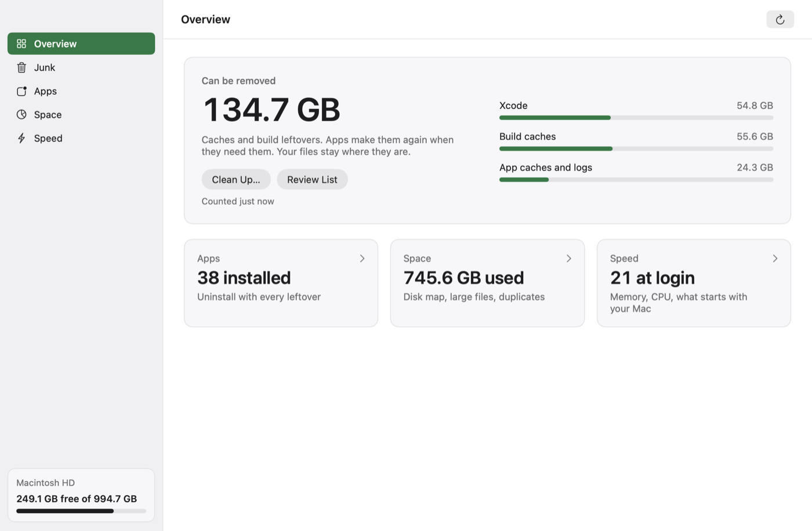
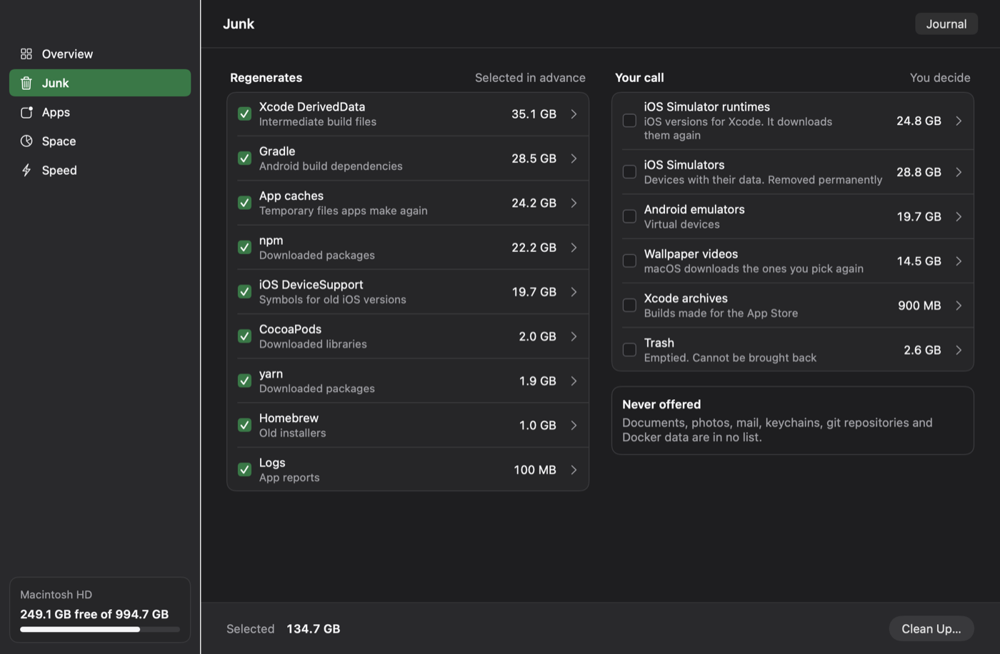
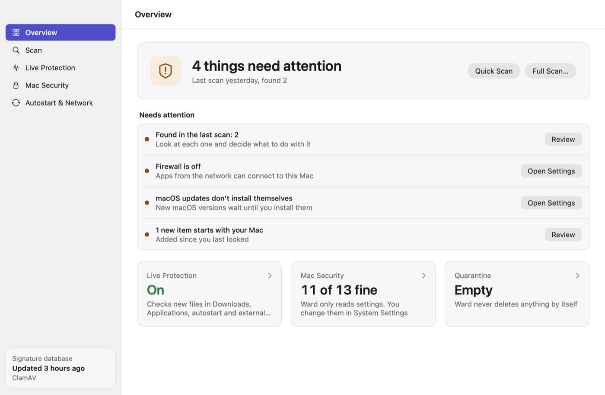
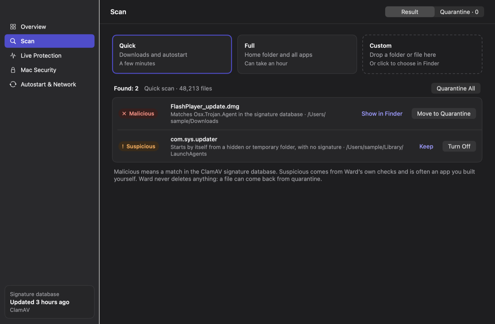

# Tidy and Ward

[](https://github.com/vdzeer/mac-care/releases/latest)
[](https://github.com/vdzeer/mac-care/releases)
[](https://github.com/vdzeer/mac-care/actions/workflows/ci.yml)
[](https://github.com/vdzeer/mac-care#install)
[](https://github.com/vdzeer/mac-care/blob/main/LICENSE)

Two small, separate macOS apps that share one codebase:

- **Tidy** frees disk space: caches and build leftovers, apps together with everything they
  left behind, large files and duplicates, and what macOS lumps together as System Data.
- **Ward** looks after security: it scans for malware with ClamAV, watches new files as they
  appear, checks the Mac's security settings, and shows what starts by itself and what talks
  to the network.

Both live in the menu bar. Their window opens when you start them or pick Open from the menu;
while it is open, the app also shows in the Dock with a full app menu. Neither has an account,
a server or analytics, and neither sends anything about you or your Mac anywhere.

<p>
  
  
</p>
<p>
  
  
</p>

## Install

Download `Tidy-<version>.dmg` and `Ward-<version>.dmg` from the
[Releases](https://github.com/vdzeer/mac-care/releases) page and drag the apps to Applications.
They are signed with a Developer ID and notarized by Apple. Or
[build them yourself](#build-from-source).

Both apps keep themselves up to date: once a day they read a small feed from the latest
GitHub release, download a new version from there and install it when the app is not busy,
with no window open; otherwise when you quit it. An update goes in only when its EdDSA
signature matches the key built into the app. No system profile is sent. Settings (⌘,) can
switch automatic checks or installs off, and the app menu has Check for Updates.

Requirements: macOS 26 or later on a Mac with Apple silicon. Ward also needs ClamAV:

```sh
brew install clamav
```

### Permissions

The first time you open each app, it shows its own window with what it needs and why:

- **Full Disk Access** (both apps). macOS has no prompt for it, so the button opens the right
  page of System Settings, where you turn the app on. The window notices by itself when access
  is on. Without it the apps still work, but they cannot see the Trash, Downloads, Desktop and
  the data of other apps, and they say so.
- **Notifications** (Ward), so live protection can tell you what it found.
- **ClamAV** (Ward), with a button that copies the install command.

Every system dialog the apps cause names the app itself, including the administrator password
dialog for switching a system service off. Settings (⌘,) shows the same status later.

## Tidy

| Screen | What it does |
| --- | --- |
| Overview | How much can be removed without harm, and what it is made of |
| Junk | On the left, what regenerates (selected in advance). On the right, your call: simulators, emulators, archives, the Trash |
| Apps | Removes an app together with its files; lists leftovers of apps that are already gone |
| Space | A map of the disk, large files, duplicates, and System Data: what that line in macOS storage is made of |
| Speed | Memory, CPU, the heaviest processes, switches for the background services that start with your Mac |

The menu bar panel shows memory, CPU, disk, network and how much can be removed.

How Tidy removes things:

- What regenerates, or can be downloaded again (wallpaper videos, Android SDK parts,
  `~/.cache`), is deleted right after you confirm the list.
- What cannot come back goes to the Trash, so you can put it back: Android emulators and Xcode
  archives, and in Apps and Space the apps and files you remove.
- When something went to the Trash, the result offers Empty Trash, so the space really comes
  back. It empties the whole Trash and asks first.
- The screen says what is removed permanently before the button.
- Every cleanup is written to a journal (Junk → Journal).

- Uninstalling moves the app itself first. If it cannot go (an App Store or system app owned by
  root), nothing else of it is touched, so its data never goes without it. Files that belong to
  a sibling app (Chrome and Chrome Beta, IntelliJ and IntelliJ CE) stay with that app.
- Leftovers of apps that are already gone start unticked: you pick what goes.
- Duplicates count a copy that shares its space with another (an APFS clone, which is what
  Finder makes) as no waste, skip files that are only in iCloud, and are compared once more
  right before they go.

What Tidy never offers: documents, photos, mail, keychains, git repositories and Docker data.
Caches of an app that is running are skipped; DerivedData, Gradle and JetBrains caches are left
alone while Xcode, Android Studio or a JetBrains IDE is open, checked again right before the
cleanup, not only when the list was made. Browsers downloaded by Playwright and Cypress are your
call: they do not come back until you install them again.

## Ward

| Screen | What it does |
| --- | --- |
| Overview | What needs attention right now |
| Scan | Quick, full, or a folder you choose. Findings go to quarantine, from where they can come back |
| Live Protection | Checks new files in Downloads, Applications, autostart folders and on external disks |
| Mac Security | Thirteen macOS settings, each with a link to the right page of System Settings |
| Autostart & Network | Background services that start by themselves, who signed them, and which apps use the network right now |

Findings come in two levels: **malicious** (a match in the ClamAV signature database) and
**suspicious** (Ward's own checks of signatures and autostart entries). A new app that a
developer signed but Apple did not notarize is suspicious too: nobody checked it for malware.
Suspicious does not mean malicious: apps you built yourself are flagged too.

What Ward does not do: it does not block apps from opening or block network traffic, it never
deletes anything by itself, and it never changes settings for you. It is no replacement for the
protection built into macOS.

The signature database updates before a scan when it is more than a day old, and once a day
while live protection is on; without a network the previous one is used. While live protection
is on, ClamAV keeps the database in memory: about 1 GB. Live protection also makes Ward start
when you log in. A file is checked once it has stopped changing, so a large copy is checked
once. If the engine stops answering, the screen and the menu bar icon say so and the files are
marked "not checked" rather than clean; a long scan asks the engine every 30 seconds and ends
after three missed answers. Quarantine All takes only malicious findings; suspicious
ones are yours to decide. Files that are only in iCloud are not downloaded to be scanned.

Apps that open when you log in (the "Open at Login" list) are not shown: since macOS 27 the
only way to read that list, `sfltool dumpbtm`, asks for an administrator password. Both apps
link to System Settings → General → Login Items instead.

## Build from source

You need Xcode 26 or later (Swift 6.2). The one dependency is
[Sparkle](https://sparkle-project.org) for updates, fetched by Swift Package Manager at the exact
version in `Package.swift`.

```sh
git clone https://github.com/vdzeer/mac-care.git
cd mac-care
scripts/build-apps.sh               # build, copy to ~/Applications, start both
scripts/build-apps.sh --no-install  # build/Tidy.app and build/Ward.app only
```

macOS ties Full Disk Access to the app's signature. Set `SIGN_IDENTITY` to one of your
certificates (an Apple Development one is enough) so the permission survives a rebuild;
without it the apps are signed ad hoc.

Checks: `scripts/gates.sh` (formatter in lint mode, a build with warnings as errors, the tests).
Release: `scripts/release.sh` makes notarized disk images and the update feeds signed with the
update key; `scripts/release.sh --check` says whether signing, notarization and the key are set
up.

## Uninstall

```sh
rm -rf /Applications/Tidy.app /Applications/Ward.app   # or ~/Applications
rm -rf ~/Library/Application\ Support/Tidy ~/Library/Application\ Support/Ward
brew uninstall clamav
```

Ward's folder holds the signature database and the quarantine: put back anything you need
from quarantine before you remove it. If you turned on live protection or Open at Login, the
apps are also listed in System Settings → General → Login Items until you remove them.

## License

[MIT](LICENSE). ClamAV is a separate program under the GPL; Ward runs it and does not include it.
